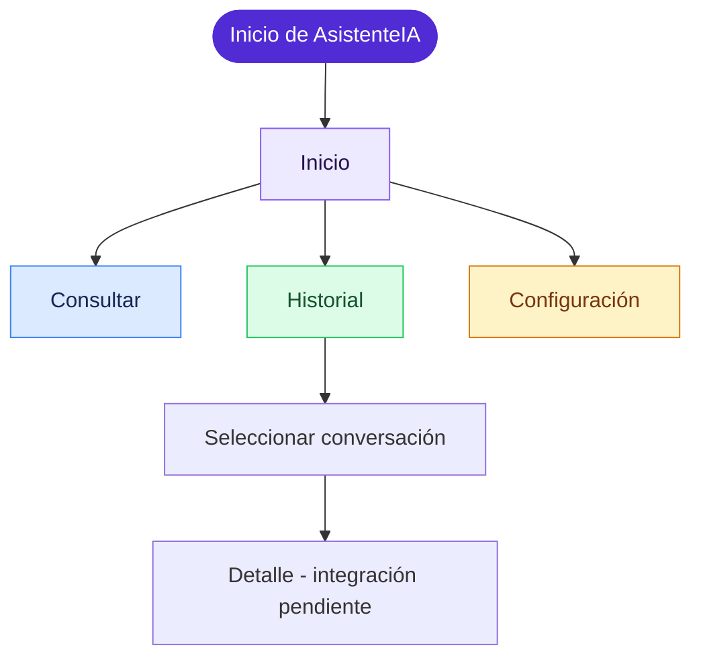
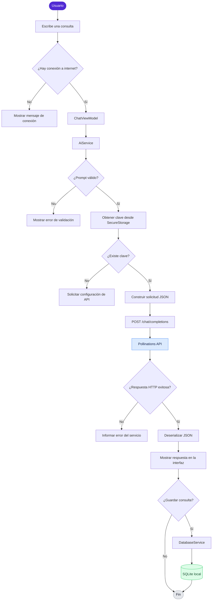
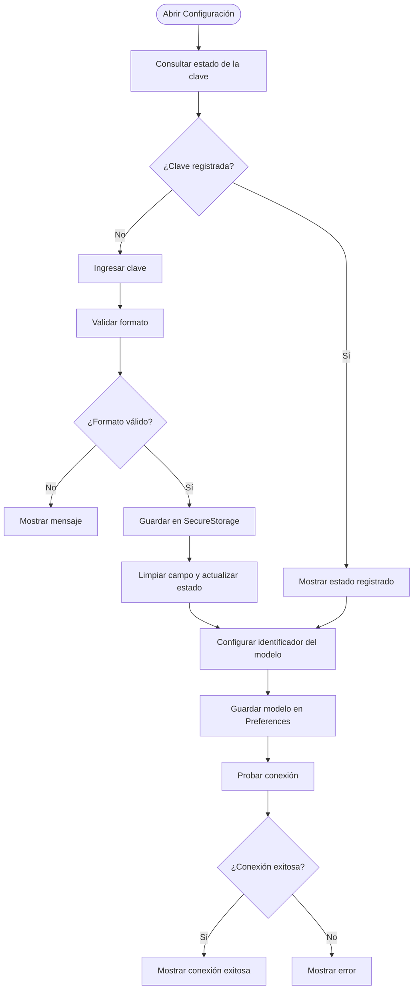
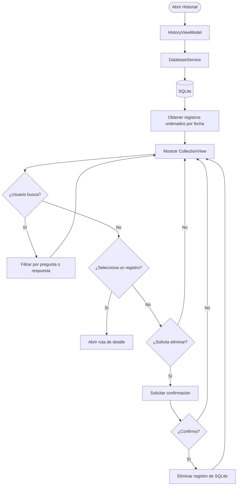
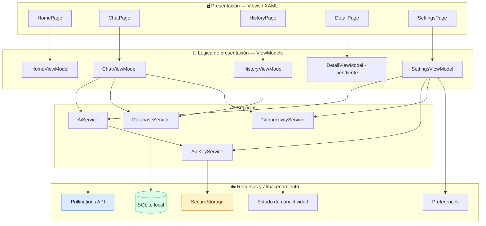

🤖 AsistenteIA
Tu apoyo académico impulsado por inteligencia artificial.
Aplicación multiplataforma desarrollada con .NET MAUI y C# que permite realizar consultas académicas a un modelo de IA, utilizar plantillas de prompts y conservar un historial local de conversaciones.

Sobre el proyecto • Funcionalidades • Flujos • Arquitectura • Instalación

📌 Sobre el proyecto
AsistenteIA es una aplicación académica diseñada para apoyar actividades de estudio mediante consultas a un servicio de inteligencia artificial. Su objetivo es ofrecer una experiencia sencilla: el usuario escribe una pregunta, puede partir de una plantilla, recibe una respuesta y decide si desea conservarla en su historial.

La aplicación integra una interfaz construida con .NET MAUI, una organización basada en MVVM, comunicación HTTP con un endpoint compatible con Chat Completions y almacenamiento local mediante SQLite.

El proyecto hace parte del trabajo académico de Programación Avanzada y Aplicada, de la Universidad de San Buenaventura.
⚠️ Uso responsable: las respuestas generadas por IA pueden contener errores o información no verificada. Contrasta los resultados con fuentes confiables y evita introducir datos personales, contraseñas o información confidencial.

✨ Funcionalidades
Módulo	Descripción
🏠 Inicio	Presenta el propósito de la aplicación y recomendaciones de uso. Incluye accesos a consultas e historial.
💬 Consultas a IA	Permite redactar una pregunta, enviarla al servicio de IA y visualizar la respuesta.
🧩 Plantillas de prompts	Ofrece ejemplos para explicar conceptos, resumir temas, crear ejemplos, practicar preguntas y comparar conceptos.
⏳ Control de consulta	Muestra el estado del proceso y permite cancelar una solicitud en curso.
💾 Historial local	Guarda preguntas y respuestas en una base de datos SQLite en el dispositivo.
🔎 Búsqueda	Filtra las conversaciones guardadas por coincidencias en la pregunta o respuesta.
⚙️ Configuración	Permite guardar o eliminar la clave de API, definir el identificador del modelo y probar la conexión.
📄 Detalle de conversación	Cuenta con una vista para consultar el contenido de un registro guardado. La integración del ViewModel de detalle está pendiente de completar.

🧭 Flujos de la aplicación
Los siguientes diagramas representan el comportamiento identificado en el código fuente.
1. Navegación general
La navegación principal se organiza mediante una barra de pestañas de .NET MAUI Shell. La vista de detalle se registra como una ruta adicional.

2. Flujo de consulta a la inteligencia artificial
Este es el recorrido central de la aplicación. El ViewModel recibe la acción de la interfaz y coordina la validación, conectividad, solicitud HTTP y presentación del resultado.

Validaciones identificadas en el servicio:
- La consulta se limpia con Trim().
- Se rechazan textos con menos de 5 caracteres.
- Se rechazan textos con más de 2.000 caracteres.
- Se requiere una clave de API almacenada.
- La solicitud utiliza autenticación HTTP Bearer.
- La aplicación contempla errores de autorización, errores HTTP, cancelación y fallos inesperados.
3. Flujo de configuración

4. Flujo del historial

🏗️ Arquitectura
El proyecto utiliza una separación de responsabilidades inspirada en el patrón Model–View–ViewModel (MVVM). La interfaz XAML se conecta con los ViewModels mediante Data Binding y comandos; los ViewModels coordinan los servicios que se encargan de la comunicación y persistencia.

Nota sobre el estado actual: DetailPage está creada y la ruta detalle está registrada en AppShell, pero DetailViewModel.cs conserva actualmente una clase plantilla de MAUI (Window). No implementa las propiedades ni operaciones que requiere la vista. Por eso, la conexión del detalle se muestra como pendiente en el diagrama.

Tecnologías y herramientas
Tecnología	Uso
C#	Lenguaje principal de desarrollo.
.NET 9	Plataforma de ejecución y compilación configurada.
.NET MAUI	Desarrollo de interfaz multiplataforma.
XAML	Construcción declarativa de las vistas.
MVVM	Separación entre interfaz y lógica de presentación.
CommunityToolkit.Mvvm 8.4.2	Propiedades observables y comandos mediante atributos.
HttpClient	Comunicación HTTP con el proveedor de IA.
System.Text.Json	Serialización y deserialización de JSON.
SQLite (sqlite-net-pcl 1.11.285)	Persistencia local del historial.
SecureStorage	Almacenamiento de la clave de API en el dispositivo.
Preferences	Persistencia de la selección del modelo.
Microsoft.Extensions.DependencyInjection	Registro e inyección de dependencias.

Integración con inteligencia artificial
La aplicación configura un cliente HTTP con la siguiente dirección base:
https://gen.pollinations.ai/v1/
La consulta se envía mediante el endpoint:
POST /chat/completions
Authorization: Bearer <API_KEY>
Content-Type: application/json
Ejemplo simplificado del cuerpo JSON:
{
  "model": "openai/gpt-5.4-nano",
  "messages": [
    {
      "role": "system",
      "content": "Eres un asistente académico. Responde de forma clara..."
    },
    {
      "role": "user",
      "content": "Explica qué es la programación orientada a objetos."
    }
  ]
}
El identificador del modelo se puede modificar desde Configuración. El valor inicial configurado en el código es openai/gpt-5.4-nano.
📂 Estructura del proyecto
La siguiente estructura resume los archivos relevantes del repositorio:
AsistenteIA/
│
├── AsistenteIA.sln
│
└── AsistenteIA/
    │
    ├── App.xaml
    ├── App.xaml.cs
    ├── AppShell.xaml
    ├── AppShell.xaml.cs
    ├── MauiProgram.cs
    ├── AsistenteIA.csproj
    ├── GlobalXmlns.cs
    │
    ├── Models/
    │   ├── ChatModels.cs
    │   ├── ConversationRecord.cs
    │   └── PromptTemplate.cs
    │
    ├── Services/
    │   ├── AiService.cs
    │   ├── ApiKeyService.cs
    │   ├── ConnectivityService.cs
    │   └── DatabaseService.cs
    │
    ├── ViewModels/
    │   ├── HomeViewModel.cs
    │   ├── ChatViewModel.cs
    │   ├── HistoryViewModel.cs
    │   ├── DetailViewModel.cs
    │   └── SettingsViewModel.cs
    │
    ├── Views/
    │   ├── HomePage.xaml
    │   ├── HomePage.xaml.cs
    │   ├── ChatPage.xaml
    │   ├── ChatPage.xaml.cs
    │   ├── HistoryPage.xaml
    │   ├── HistoryPage.xaml.cs
    │   ├── DetailPage.xaml
    │   ├── DetailPage.xaml.cs
    │   ├── SettingsPage.xaml
    │   └── SettingsPage.xaml.cs
    │
    ├── Platforms/
    │   ├── Android/
    │   ├── Windows/
    │   ├── iOS/
    │   ├── MacCatalyst/
    │   └── Tizen/
    │
    └── Resources/
        ├── AppIcon/
        ├── Fonts/
        ├── Images/
        ├── Raw/
        ├── Splash/
        └── Styles/
Responsabilidad de las capas
- Views: muestran la interfaz y enlazan controles con propiedades y comandos.
- ViewModels: administran el estado de la pantalla y coordinan las acciones del usuario.
- Services: encapsulan la comunicación con la API, el acceso a la clave, la conectividad y la base de datos.
- Models: representan las solicitudes y respuestas JSON, las conversaciones y las plantillas.
🚀 Instalación y ejecución
Requisitos previos
- Visual Studio 2022 con la carga de trabajo Desarrollo de la interfaz de usuario de aplicaciones multiplataforma .NET (.NET MAUI), o un entorno compatible con .NET MAUI.
- SDK de .NET 9.
- Android SDK y un emulador o dispositivo Android para ejecutar la aplicación en Android.
- Windows 10/11 para compilar y ejecutar el destino Windows configurado.
- Una clave de API válida del proveedor Pollinations.
El archivo de proyecto configura net9.0-android y agrega net9.0-windows10.0.19041.0 cuando se compila en Windows. Aunque existen carpetas de otras plataformas, esos destinos no están habilitados actualmente en el archivo .csproj.

1. Clonar el repositorio
git clone https://github.com/Cristianm23/AsistenteIA.git
cd AsistenteIA
2. Restaurar dependencias
Desde la carpeta raíz de la solución:
dotnet restore AsistenteIA.sln
3. Compilar para Android
dotnet build AsistenteIA/AsistenteIA.csproj -f net9.0-android
Para ejecutar desde Visual Studio, abre AsistenteIA.sln, selecciona un emulador o dispositivo Android y ejecuta el proyecto.
4. Compilar para Windows
En un entorno Windows con las herramientas MAUI correspondientes:
dotnet build AsistenteIA/AsistenteIA.csproj -f net9.0-windows10.0.19041.0
5. Configurar la API
1. Inicia la aplicación.
2. Abre la pestaña Configuración.
3. Introduce tu clave de API.
4. Guarda la clave.
5. Conserva el modelo predeterminado o introduce otro identificador compatible.
6. Selecciona Probar conexión.
7. Cuando la prueba sea exitosa, abre Consultar para realizar una pregunta.
Importante: no guardes claves reales en el código fuente, en archivos versionados ni en capturas públicas. La aplicación utiliza SecureStorage para guardar la clave en el dispositivo.
🔐 Privacidad y manejo de información
- La clave de API se guarda mediante SecureStorage; la interfaz solo informa si existe una clave registrada.
- El historial se almacena en una base de datos SQLite dentro del directorio de datos de la aplicación.
- La selección del modelo se conserva mediante Preferences.
- Las consultas se transmiten al proveedor externo de IA para generar respuestas.
- No introduzcas datos personales ni información confidencial en los prompts.
La persistencia local del historial no significa que las consultas enviadas al proveedor externo permanezcan exclusivamente en el dispositivo. Consulta las condiciones y políticas del proveedor antes de utilizar la aplicación con información sensible.
🛠️ Estado del desarrollo
Componente	Estado observado en el código
Navegación principal	Implementada con MAUI Shell.
Pantalla de inicio	Implementada.
Envío de consultas a IA	Implementado en AiService y ChatViewModel.
Plantillas de prompts	Implementadas.
Gestión de clave de API	Implementada con SecureStorage.
Selección de modelo	Implementada con Preferences.
Persistencia de conversaciones	Implementada con SQLite.
Búsqueda y eliminación del historial	Implementadas en el ViewModel.
Vista de detalle	Vista y ruta creadas; ViewModel e integración pendientes.
Verificación persistente de respuestas	Pendiente de completar.

🎓 Contexto académico
Proyecto: AsistenteIA
Asignatura: Programación Avanzada y Aplicada
Institución: Universidad de San Buenaventura
Autores: Cristian Muñoz y Juan Higuera

El proyecto aplica conceptos de programación orientada a objetos, interfaces declarativas con XAML, patrón MVVM, consumo de servicios REST, manejo de JSON, inyección de dependencias y persistencia local.
👨‍💻 Autoría
Desarrollado como proyecto académico por:
- Cristian Muñoz
- Juan Higuera
Repositorio: github.com/Cristianm23/AsistenteIA

AsistenteIA · Aprender, consultar y explorar con apoyo de IA.

Desarrollado con C# y .NET MAUI.

