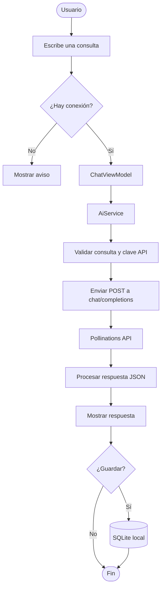
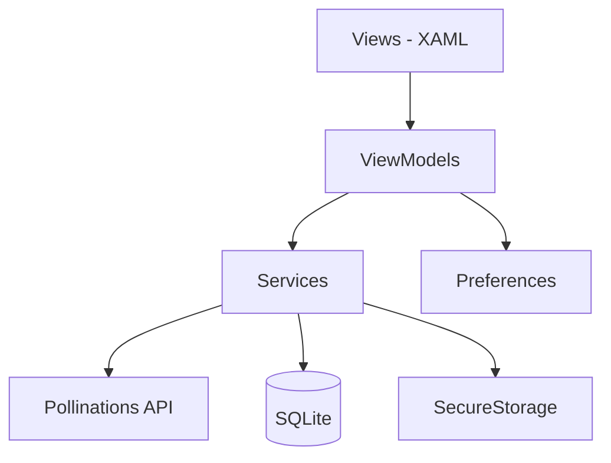

# AsistenteIA

Asistente académico móvil con inteligencia artificial, desarrollado con **.NET MAUI** como proyecto final de *Programación Avanzada y Aplicada* (VI semestre, Tecnología en Desarrollo de Software, Universidad de San Buenaventura).

## Descripción

AsistenteIA permite formular consultas académicas a un servicio de inteligencia artificial, usar plantillas de prompts editables, recibir respuestas y guardar las conversaciones en un historial local. La app consume la API de **Pollinations** (endpoint compatible con Chat Completions) mediante solicitudes POST con JSON, sin backend propio.

Está orientada al apoyo del aprendizaje: explicar conceptos, resumir temas, comparar ideas, crear ejemplos y generar preguntas de práctica.

## Funcionalidades

| Pantalla | Función |
|---|---|
| **Inicio** | Presenta el propósito de la app, recomendaciones de uso y accesos rápidos. |
| **Consultar** | Captura el prompt (5 a 120 caracteres), permite elegir una plantilla editable, envía la consulta, muestra la respuesta, permite cancelar y guardar. |
| **Historial** | Lista las conversaciones guardadas (más recientes primero), con búsqueda por consulta o respuesta y eliminación con confirmación. |
| **Detalle** | Muestra consulta, respuesta, fecha y categoría; permite marcar la respuesta como verificada y guardar el cambio. |
| **Configuración** | Registra o elimina la clave API (sin mostrarla), define el identificador del modelo, prueba la conexión e incluye la sección *Acerca de*. |

Plantillas disponibles: explicar, resumir, crear ejemplos, preguntas de práctica y comparar conceptos.

## Flujo principal



## Arquitectura

Patrón **MVVM** con inyección de dependencias:



- **Views:** interfaz XAML y navegación con Shell.
- **ViewModels:** estado, comandos y validación de interacción de cada pantalla.
- **Services:** `AiService` (API REST), `ApiKeyService` (SecureStorage), `DatabaseService` (SQLite) y `ConnectivityService` (estado de red).
- **Models:** `ChatRequest`, `ChatResponse`, `ChatMessage`, `ConversationRecord` y `PromptTemplate`.

## Tecnologías

| Tecnología | Uso |
|---|---|
| C# / .NET 9 | Lenguaje y plataforma |
| .NET MAUI / XAML | Aplicación e interfaz multiplataforma |
| CommunityToolkit.Mvvm 8.4.2 | Propiedades observables y comandos |
| sqlite-net-pcl 1.11.285 | Historial local en SQLite |
| HttpClient / System.Text.Json | Consumo REST y serialización JSON |
| Pollinations API | Generación de respuestas |
| SecureStorage | Almacenamiento seguro de la clave API |
| Preferences | Identificador del modelo seleccionado |

## Estructura del proyecto

```
AsistenteIA/
├── Models/
│   ├── ChatModels.cs
│   ├── ConversationRecord.cs
│   └── PromptTemplate.cs
├── Services/
│   ├── AiService.cs
│   ├── ApiKeyService.cs
│   ├── ConnectivityService.cs
│   └── DatabaseService.cs
├── ViewModels/
│   ├── ChatViewModel.cs
│   ├── DetailViewModel.cs
│   ├── HistoryViewModel.cs
│   ├── HomeViewModel.cs
│   └── SettingsViewModel.cs
├── Views/
│   ├── ChatPage.xaml
│   ├── DetailPage.xaml
│   ├── HistoryPage.xaml
│   ├── HomePage.xaml
│   └── SettingsPage.xaml
├── Platforms/
├── Resources/
├── App.xaml
├── AppShell.xaml
├── MauiProgram.cs
└── AsistenteIA.csproj
```

## Instalación y ejecución

**Requisitos:** SDK de .NET 9, Visual Studio 2022 con la carga de trabajo de .NET MAUI, y Android SDK o un entorno Windows compatible. La app fue probada en **Windows**.

```bash
git clone https://github.com/Cristianm23/AsistenteIA.git
cd AsistenteIA
dotnet restore AsistenteIA.sln

# Android
dotnet build AsistenteIA/AsistenteIA.csproj -f net9.0-android

# Windows (desde un equipo Windows con las herramientas MAUI)
dotnet build AsistenteIA/AsistenteIA.csproj -f net9.0-windows10.0.19041.0
```

También puede ejecutarse desde Visual Studio seleccionando *Windows Machine*, un emulador Android o un dispositivo conectado.

## Configuración inicial

1. Abrir la pestaña **Configuración**.
2. Pegar la clave de Pollinations en *Clave de la API* (el campo oculta los caracteres) y pulsar **Guardar clave**. La app valida que comience por `sk_` o `pk_`; es solo una comprobación superficial.
3. Dejar el modelo predeterminado (`openai/gpt-5.4-nano`) o escribir otro y pulsar **Guardar modelo**.
4. Pulsar **Probar conexión** para confirmar que el servicio responde.

> La clave se guarda con SecureStorage. **No publiques claves reales ni las incluyas en el código, capturas o commits.** Si sospechas que una clave se expuso, revócala en el proveedor y registra una nueva.

## Seguridad, privacidad y uso responsable

- La clave API se almacena con SecureStorage y nunca se muestra ni se registra en consola.
- La comunicación con el proveedor usa HTTPS.
- Las consultas y respuestas se envían a un proveedor externo (Pollinations): **no ingreses datos personales, contraseñas ni información confidencial**. La app lo advierte en Inicio, Consultar y Configuración.
- El historial se guarda localmente en el dispositivo (`asistente.db3`) y no se sincroniza con ningún servidor.
- Las respuestas de la IA pueden ser incorrectas o desactualizadas. La marca *Respuesta verificada* es una declaración manual del usuario, no una verificación automática.

La matriz completa de riesgos está en la documentación técnica del proyecto.

## Pruebas

Casos de prueba ejecutados sobre la app en Windows, con evidencias en la documentación técnica:

| Caso | Escenario | Resultado |
|---|---|---|
| Consulta válida | Prompt de 5 a 120 caracteres con clave válida | [completar] |
| Prompt inválido | Menos de 5 o más de 120 caracteres | [completar] |
| Sin clave | No se envía solicitud; mensaje de configuración | [completar] |
| Clave inválida | Mensaje de autorización sin mostrar la clave | [completar] |
| Sin conexión | La app no se cierra y muestra aviso | [completar] |
| Cancelar / timeout | Se restablece el estado y se puede reintentar | [completar] |
| Guardar consulta | Aparece en el historial | [completar] |
| Buscar y eliminar | Filtra y elimina con confirmación | [completar] |
| Verificar respuesta | `IsVerified` persiste tras guardar | [completar] |
| Reinicio de la app | El historial permanece | [completar] |
| Pantalla pequeña | Los controles siguen accesibles | [completar] |

## Limitaciones conocidas

- Requiere conexión a Internet para generar respuestas; el historial local se consulta sin conexión.
- El límite de 120 caracteres para el prompt está definido por el proyecto.
- No hay reintentos automáticos ni manejo específico de códigos 429 o 5xx; el usuario reintenta manualmente.
- No hay streaming: la app espera la respuesta HTTP completa.
- El identificador del modelo se escribe a mano; la disponibilidad de modelos depende del proveedor.
- Probada únicamente en Windows.

## Declaración de uso de herramientas de IA

[Completar con honestidad: qué herramientas de IA se usaron (por ejemplo GitHub Copilot u otros asistentes), para qué tareas (código, documentación, depuración) y qué decisiones de diseño y revisión fueron del equipo.]

## Documentación

- Documentación técnica: requisitos, arquitectura, decisiones técnicas, consumo REST, matriz de riesgos, manual de usuario y manual técnico. [Agregar enlace o ruta al archivo]
- Ejecutable o APK: [Agregar enlace a la sección *Releases*]
- Video de funcionamiento: [Agregar enlace]

## Autores

- Cristian Fabián Muñoz Solórzano
- Juan Felipe Higuera Pérez

Docente: Sandra Esperanza Sánchez Barragán
Programación Avanzada y Aplicada, Universidad de San Buenaventura, 2026.
