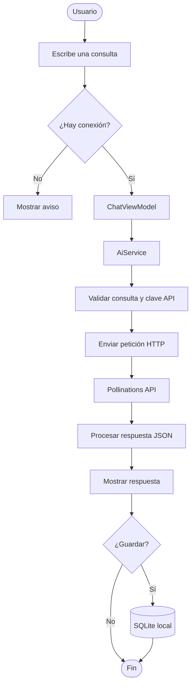
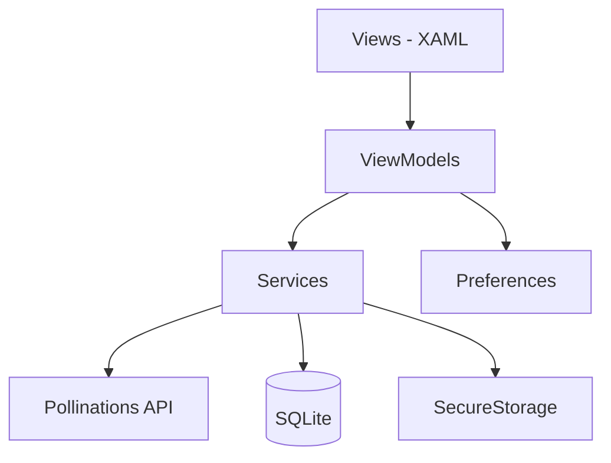

📌 Descripción
AsistenteIA es una aplicación académica que permite realizar
consultas a un servicio de inteligencia artificial, utilizar plantillas
para formular preguntas y guardar las conversaciones en un historial
local.

El proyecto está desarrollado con .NET MAUI, utiliza el patrón
MVVM, consume la API de Pollinations y almacena los registros
mediante SQLite.
✨ Funcionalidades
- Inicio: presentación de la aplicación y recomendaciones de uso.
- Consultas IA: envío de preguntas y visualización de respuestas.
- Plantillas: ejemplos para resumir, explicar, comparar y
  practicar conceptos.
- Historial: almacenamiento, búsqueda y eliminación de
  conversaciones.
- Configuración: gestión de la clave API, selección del modelo y
  prueba de conexión.
- Detalle: pantalla destinada a consultar una conversación
  guardada.
🔄 Flujo principal

🏗️ Arquitectura
La aplicación organiza sus responsabilidades mediante MVVM:

- Views: interfaz y navegación.
- ViewModels: estado y comandos de cada pantalla.
- Services: consumo de API, conectividad, clave y base de datos.
- Models: estructuras de solicitudes, respuestas, plantillas y
  conversaciones.
🧰 Tecnologías
  Tecnología              Uso
  C# / .NET 9             Lenguaje y plataforma
.NET MAUI / XAML        Aplicación e interfaz
CommunityToolkit.Mvvm   Implementación de MVVM
HttpClient / JSON       Consumo de API REST
Pollinations API        Generación de respuestas
SQLite                  Historial local
SecureStorage           Almacenamiento de la clave API
Preferences             Configuración del modelo
📁 Estructura
AsistenteIA/
├── Models/
├── Services/
├── ViewModels/
├── Views/
├── Platforms/
├── Resources/
├── App.xaml
├── AppShell.xaml
└── MauiProgram.cs
🚀 Instalación
Requisitos: SDK de .NET 9, Visual Studio 2022 con la carga de
trabajo .NET MAUI y Android SDK o entorno Windows compatible.
1. Clonar el repositorio:
   git clone https://github.com/Cristianm23/AsistenteIA.git
   cd AsistenteIA
2. Restaurar dependencias:
   dotnet restore AsistenteIA.sln
3. Compilar para Android:
   dotnet build AsistenteIA/AsistenteIA.csproj -f net9.0-android
4. Ejecutar la aplicación desde Visual Studio en un emulador o
   dispositivo compatible.
5. En Configuración, registrar la clave de API, seleccionar el
   modelo y probar la conexión.
La clave se guarda mediante SecureStorage. No publiques claves
reales ni las incluyas en el código fuente.

ℹ️ Estado del proyecto
La consulta a IA, configuración, navegación principal e historial local
están implementados. La integración de la pantalla de detalle y la
persistencia de la verificación de respuestas requieren completar su
ViewModel.
👨‍💻 Autores
Cristian Muñoz y Juan Higuera
Proyecto académico --- Programación Avanzada y Aplicada
Universidad de San Buenaventura
